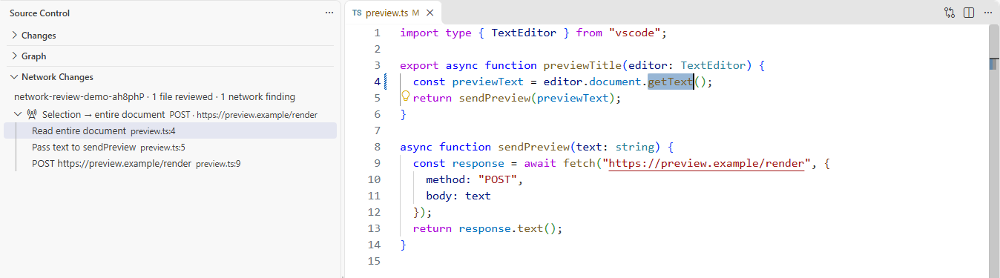

# Network Change Review

A desktop VS Code extension that compares saved Git changes with `HEAD`. It finds new or changed `fetch` requests and flags a one-line edit that allows an existing request to send the entire editor document where it previously sent only the selection. The review runs locally.



## Try the preview

1. From this folder, run `npm ci` and `npm run package`. In VS Code, run **Extensions: Install from VSIX…** and select `dist/network-change-review-0.2.0.vsix`.
2. Open a trusted Git folder, save your edits, and run **Network Review: Review Network Changes** from the Command Palette.
3. Open a finding in **Source Control → Network Changes**. For an expanded payload, follow the source links from the document read through the helper to the request.

For example, adding this line produces a POST finding for `https://diagram.example/render` with `markdown` as its body.

```js
fetch("https://diagram.example/render", { method: "POST", body: markdown });
```

**Explain This Finding** uses a VS Code chat model when you invoke the action on a row. The model receives the method, destination, and body descriptions, including any literals in those expressions, and the scope change when present. Its response appears in the **Network Change Explanations** output channel. Source navigation and review also work offline.

## Try the one-line privacy demo

Run `npm run demo:exposure` and open the printed Git folder in VS Code. The saved edit removes the selection argument from one call.

```diff
- const previewText = editor.document.getText(editor.selection);
+ const previewText = editor.document.getText();
```

1. Run `node --test` in the demo folder. The preview still displays the same heading. The service is mocked.
2. Run **Review Network Changes**. Expand **Selection → entire document** and click the three evidence rows. They select `getText`, `sendPreview`, and the existing POST to `preview.example`.
3. Run `git restore -- preview.ts`. The test stays green and rerunning the review clears the finding.

## Try the new-request demo

From this extension folder, run `npm run demo` with Node.js 24 and Git available. The command prints the path of a fresh temporary Git repository containing a Markdown preview, fictional content, and a mocked rendering endpoint.

1. Open that folder in VS Code and open its `index.html` in a browser. The preview shows **Plan → Build → Review**. In the demo folder, run `node --test`.
2. Run **Review Network Changes**. Select the POST finding to see where the whole Markdown document is passed to `fetch`.
3. In the demo folder, run `git restore --source=local-renderer -- renderer.js`. Refresh the browser, repeat the tests, and rerun the review. The same diagram renders locally and the finding disappears.

## What the reviewer covers

- Compares saved files in the selected Git repository against `HEAD`. Staged and unstaged edits to one file are reviewed together. Includes new files and honors Git ignore rules. An initial repository with no commits uses an empty baseline.
- Parses JavaScript, JSX, TypeScript, TSX and their `.mjs`, `.cjs`, `.mts`, and `.cts` variants. Matches requests within each file by destination, method, and body, including duplicate counts. Git-detected renames use the original path as the baseline.
- Resolves literal values and marks dynamic expressions and opaque options as runtime-dependent. A finding describes a call site. The actual values and whether that path executes depend on the application.
- For the editor-data check, recognizes VS Code `TextEditor` parameters and `window.activeTextEditor`. It follows immutable aliases and up to one same-file function or arrow helper into a POST, PUT, PATCH or DELETE body with a literal HTTP(S) destination. A uniquely matched path in both versions supplies the before/after evidence.
- Cross-file helpers, more general data-flow analysis, Axios, `globalThis.fetch`, and changes to headers are outside this preview's coverage.
- Lists syntax errors, conflicts, and read failures as skipped files. The summary shows how many files were reviewed. Save and rerun after editing a result's file.

## Develop and package

Use Node.js 24.21.0, Git, and desktop VS Code 1.95 or newer. Run these commands in the extension folder.

```sh
npm ci
npm test
npm run test:host
npm run package
```

`npm test` builds the extension and checks the analyzer and both offline renderers. `npm run test:host` runs the commands in an isolated VS Code Extension Development Host using a temporary Git repository. It uses the installed Windows editor when available. Set `VSCODE_EXECUTABLE_PATH` to the editor executable on another installation, or let the test runner download VS Code.

For interactive development, open this folder in VS Code, press **F5**, and open the demo repository in the Extension Development Host. `npm run package` creates the installable preview under `dist/`.

For a pilot, share the VSIX with volunteers and ask, **“Did a finding change what you approved? If so, which one?”**
